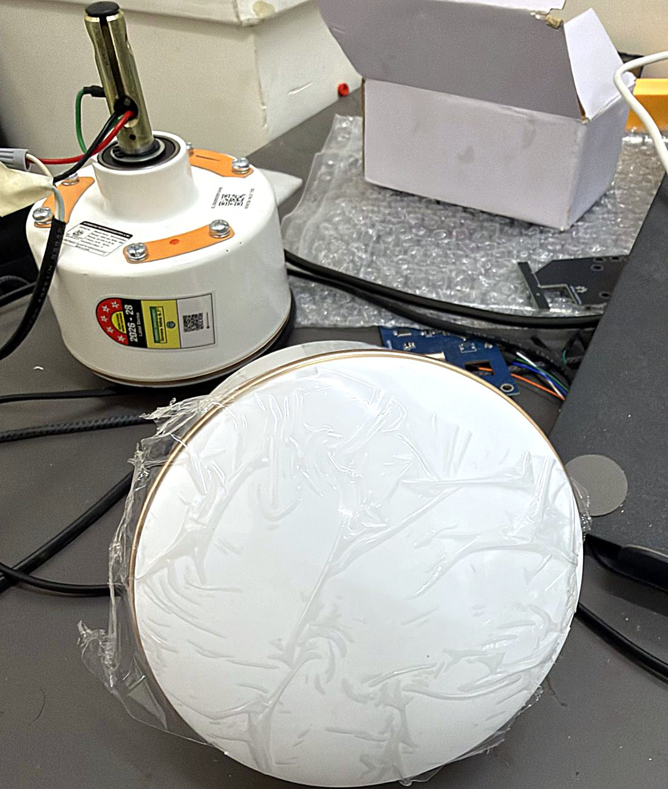
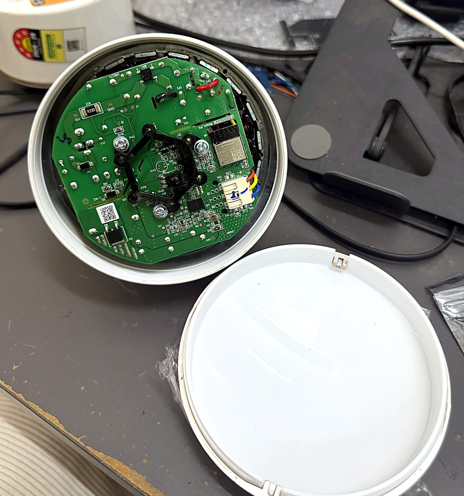
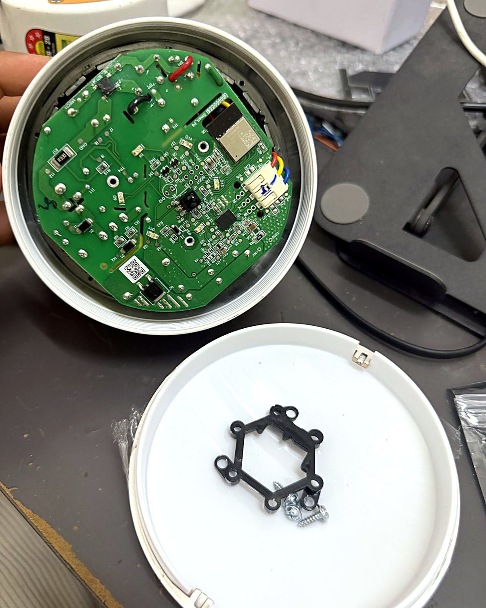
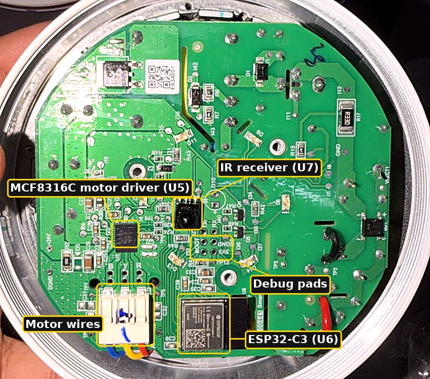
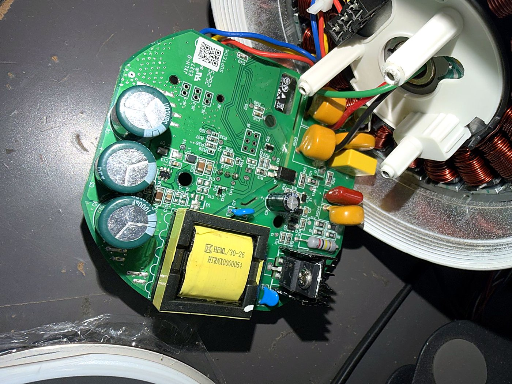
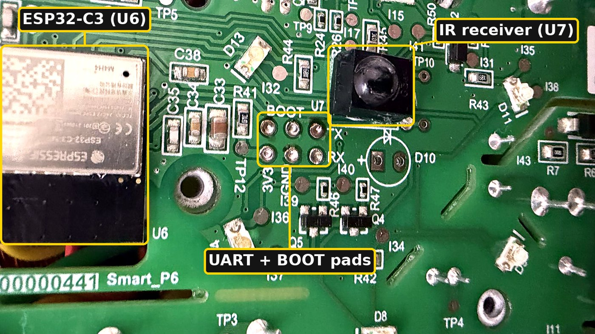
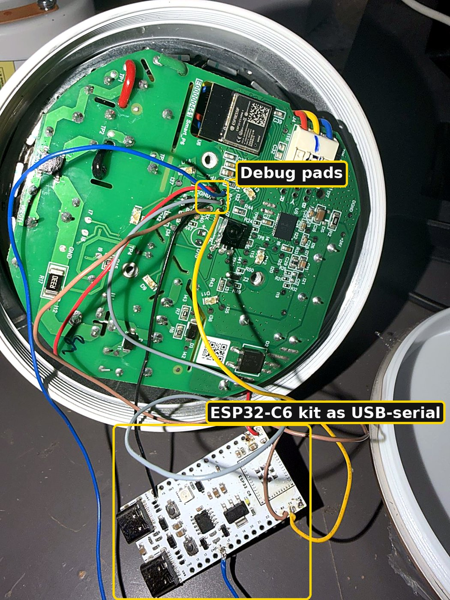

# How I turned my Atomberg ceiling fan into a Matter fan for Apple Home

*By Vishal Tejwani · November 2026*

I wanted one simple thing: say "Hey Siri, fan to 60%" and have my ceiling fan do it.

The Atomberg Renesa Prime is a great BLDC fan, but it only speaks IR. No Wi-Fi, no app, no Apple Home.
The usual fix is an IR blaster on the wall. I didn't want another gadget pointing at the ceiling.
I wanted the fan itself to be a smart fan.

So I opened it up. This post is the story of how it went from an IR-only fan to a native **Matter** device
that pairs with Apple Home by scanning a QR code, and still works with the original remote.

All the code, tools and notes are open source: **[github.com/ivishaltejwani/atomberg-matter-fan](https://github.com/ivishaltejwani/atomberg-matter-fan)**

> ⚠️ This fan runs off mains power. Opening it voids your warranty, and everything here is at your own risk.
> Do all flashing with mains disconnected.

---

## 1. Opening the fan: the surprise inside

The bottom cover comes off. Under it sits a round control board held down by a black plastic bracket.

My plan was to solder an ESP32-C3 onto this board myself.
Then I looked closer and saw a familiar silver can: **there was already an Espressif ESP32-C3 module on the board.**

The board (silkscreen `Smart_P6`) has:

- **U6:** an Espressif ESP32-C3 module, the brain. Wi-Fi and Bluetooth capable, but in this model it only reads the IR remote.
- **U5:** a **TI MCF8316C**, a sensorless FOC BLDC motor driver with its own EEPROM.
- **U7:** the IR receiver, with a ring of 6 LEDs around it for the speed display.
- A mains power stage on the other side that makes the 24 V rail for the motor.

So the hardware for a smart fan was already there. Only the firmware was missing.
**No extra parts needed.** That changed the whole project from a hardware mod to a firmware project.

## 2. The debug header

Right next to the module are six labelled pads: **BOOT, TX, RX, 3V3, GND** (plus TP12). That's UART0 and the boot strap.

I soldered wires to them and used the USB-serial chip on an ESP32-C6 dev kit as my programmer.

A few things I learned here:

- The C3 only reads BOOT (GPIO9) at power-up. Holding BOOT to GND *then* plugging in USB is the reliable way into download mode.
- The stock firmware runs a tiny command parser on UART that replies `string not matched !` to anything it doesn't know.
  That is why esptool kept failing with `Invalid head of packet (0x73)`. `0x73` is the letter `s`.
- **Flash encryption was enabled** on the chip, in development mode. Plain Arduino uploads boot-looped with `invalid header`.
  `esptool write-flash --encrypt` works, because manual encryption over UART was not disabled.

## 3. My big mistake: no backup

Early on I erased the stock firmware and flashed a blank sketch. **I didn't take a backup first.**
The stock partition table, strings and command list are gone for good.

If you try this: **dump the flash before you write anything.** Seriously.

The good news came later: the motor tuning doesn't live in the ESP32. It lives in the MCF8316C's own EEPROM, so it survived.

## 4. Mapping the board without any firmware

With the stock firmware gone, I had to work out what every GPIO does. The trick: the ESP32-C3's **ROM download mode
lets you read and write registers directly**. So I wrote [`tools/pinprobe.py`](../tools/pinprobe.py) to drive and read GPIOs
from the ROM bootloader, with nothing in flash at all.

What I found:

| What | Pins |
|---|---|
| IR receiver output | GPIO3 |
| LED matrix (2 rows × 3 columns) | rows GPIO5, GPIO6 · columns GPIO1, GPIO4, GPIO10 |
| Motor driver I2C | SDA GPIO19, SCL GPIO18, address `0x01` |
| Debug UART | GPIO20 / GPIO21 |

The 6 speed LEDs are a 2×3 matrix: an LED lights when both its row and column are HIGH.

## 5. Decoding the remote

I wrote a small IR sniffer sketch and pressed every button. The remote uses **NEC with an extended address of `0xF300`**:

| Button | Code | Button | Code |
|---|---|---|---|
| Power | `0x91` | 4 | `0x93` |
| 1 | `0x8B` | 5 | `0x88` |
| 2 | `0x90` | 6 | `0x8F` |
| 3 | `0x8A` | LED | `0x97` |
| TIMER | `0x96` | SLEEP | `0x8E` |

## 6. Talking to the motor driver

The MCF8316C speaks I2C with a slightly unusual 24-bit control word before each read or write.
Before writing anything, I dumped its whole EEPROM read-only and saved it.

Atomberg's motor tuning was all there: startup, closed-loop and fault settings, all non-default.
It was set to **I2C speed control mode**, so speed is just one register: `ALGO_DEBUG1` (`0xEC`), override bit plus a 15-bit speed value.

The first test was 5% speed for 1 second. The fan moved, with no faults afterwards.

Some tuning I had to do on top:

- Below ~15% the sensorless loop can't hold speed, so the slider maps 1–100% onto **20–100%** of the driver's max speed.
- The driver slowed down so fast that it looked like the fan was stopping. I now slew deceleration in firmware,
  fast at high speed and gentle near the bottom, following how the fan coasts down on its own with air drag.

## 7. The Matter firmware

The firmware is an Arduino sketch on **Arduino-ESP32 3.3.0**, using its `MatterFan` class.
Apple Home sees a proper fan: on/off and a speed slider. The remote still works, and the LED ring follows Home.

Three problems took most of the time.

**Unique pairing codes.** In Arduino 3.3.0, `Matter.getManualPairingCode()` returns a hardcoded test code. Every fan would share it.
So on first boot the firmware generates its own random passcode, discriminator and salt, computes the SPAKE2+ verifier with mbedTLS
(checked against the Matter test vector first) and stores it. The flash script saves the QR code as a PNG.

**"No Response" in Apple Home.** Pairing worked, then the fan went unresponsive. The prebuilt config keeps Bluetooth in RAM forever,
about 70 KB. With Apple's two fabrics (Home + iPhone), secure sessions ran out of heap.
The fix: **shut down and release Bluetooth after pairing.** Free heap went up to ~85–96 KB and the "No Response" went away.

**Remote changes not showing in Home.** `MatterFan` writes its attributes in a way that never triggers a report.
I now mark fan mode and speed dirty after every change, so pressing "4" on the remote moves the slider in Home too.

## 8. Updates without opening the fan again

Once it's on the ceiling, I'm not climbing a ladder to flash it. So the fan does **signed OTA updates over Wi-Fi**:

- The fan polls a small server on my computer every 30 s.
- It installs only firmware whose manifest is signed with **my ECDSA P-256 key**, newer than what it has, and matching the SHA-256.
- A build that crashes or doesn't get on Wi-Fi in 60 s is **rolled back automatically**, and never retried.
- Over Wi-Fi the fan accepts only read-only commands. Pairing codes, factory reset and the update server can only be changed over the serial cable.

There's also a small local dashboard with live logs, status and a drag-and-drop box for new builds.

## 9. The result

- ✅ Pairs with Apple Home by scanning a QR code (any Matter controller should work)
- ✅ On/off and a smooth speed slider, plus Siri
- ✅ Original IR remote still works: Power, speeds 1–6, LED button
- ✅ LED ring shows the speed
- ✅ Signed OTA updates with rollback
- ✅ No extra hardware. Same board, new firmware.

It shows up in Home as an uncertified accessory, because it uses the Matter test vendor ID. That's fine for a personal device.
TIMER and SLEEP on the remote aren't implemented yet.

## Try it yourself

- **Flash a ready-built image:** [FLASHING.md](../FLASHING.md)
- **Build from source with your own OTA key:** [README.md](../README.md)
- **Every hardware detail and dead end:** [findings.md](../findings.md)

Lessons, in one line each:

1. Look at the board before you buy parts. The chip you need might already be there.
2. Back up the flash before you touch it.
3. Read the motor driver's EEPROM before you write it.
4. ROM download mode is a free logic probe on an ESP32.
5. On a small chip, Bluetooth that you only need once is RAM you need forever.

If you have a Renesa Prime and try this, open an issue and tell me how it went.

---

*I build [PlaceStation](https://placestation.in), India's desktop SMT pick-and-place machine. This fan was a fun detour.*
